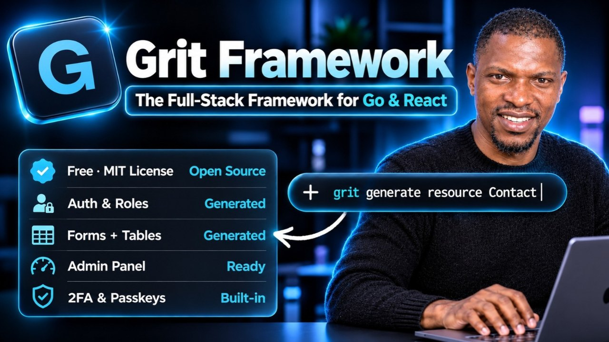
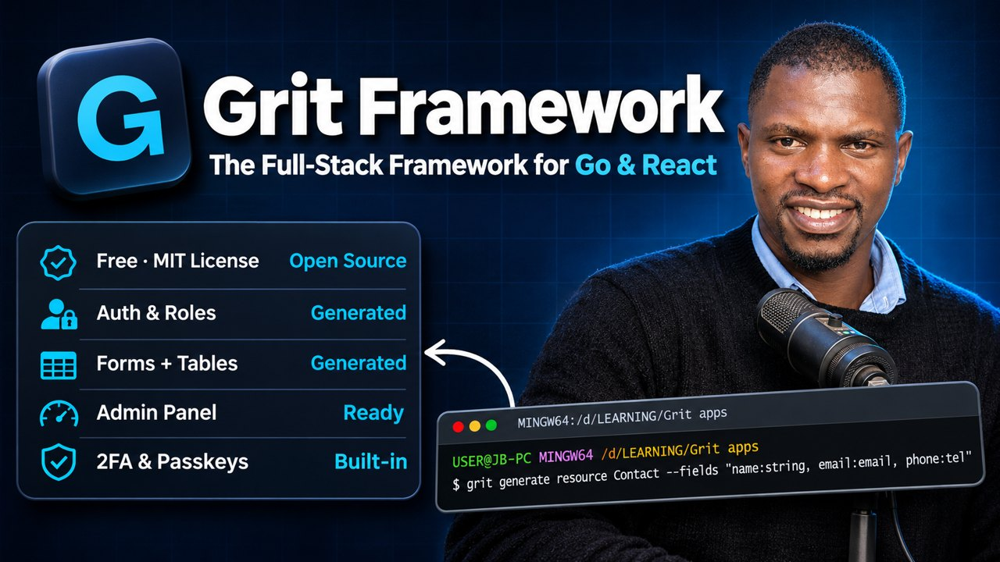
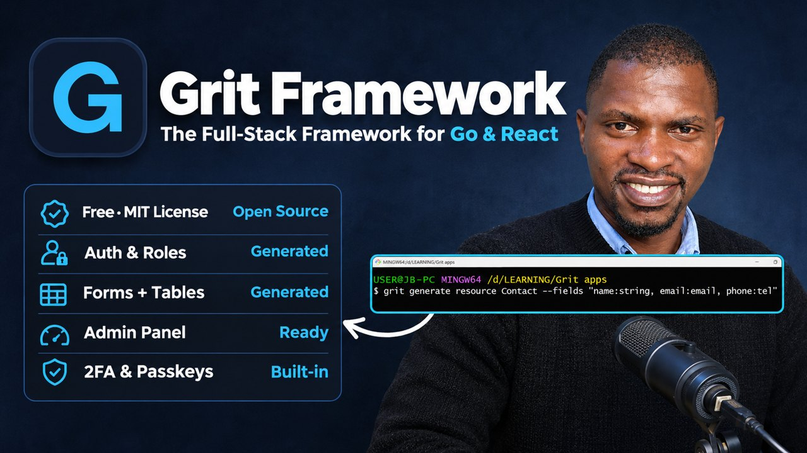

# Worked Example: YouTube Thumbnail — from AI Slop to Photoshop Master

**Video:** Grit Framework — the full-stack framework for Go & React
**Mode:** FIX MODE → FAITHFUL REMAKE + PHOTOSHOP MASTER ([AI.md §13, §14](../AI.md))
**Result:** published as is — no edits.

| Before (AI-generated) | After (final) |
|---|---|
|  |  |

---

## 1. The diagnosis (AI-look score 8/10)
- Four frosted-glass panels with glowing cyan edges (logo tile, subtitle pill, feature card, command pill)
- Cyan halo around the presenter that didn't match the warm light on his face; smooth, generated skin
- Blurred blue "studio" background with bokeh
- Lens sparkle on the logo; white-to-cyan gradient title
- Fake terminal: "+" instead of `$`, decorative cursor
- Laptop and hands that weren't in any real photo

**What worked and was kept:** the layout, the message, every piece of information, the navy-and-blue
mood (it's the real brand colour from the logo).

## 2. The assets
| Asset | Prep |
|---|---|
| Real selfie (phone, daylight, mic in front) | background with family photos removed, selfie arm removed, mic cleaned — all in the prompt |
| Real terminal screenshot | cropped to the two lines of text; used as the exact-text reference |
| Real Grit logo (PNG) | used as is, rendered as a 3D tile |
| *(Real admin panel screenshot)* | used in test 1, not needed for the faithful remake |

## 3. The iterations — what each test taught the repo

| Test | Result | Lesson → repo change |
|---|---|---|
| 1. REBUILD ("ONE COMMAND. FULL CRUD.") |  | Looked real, but the model **invented admin-panel data** ("4 records") and the user missed the old information → *screenshots are evidence* rule; FAITHFUL REMAKE fix level; pro retoucher edits (§8.F) |
| 2. FAITHFUL REMAKE |  | All info back, no slop — but flat: pasted-looking terminal, no depth, subject not integrated → PHOTOSHOP MASTER (§14): PSD layer plan, motivated light, stacked shadows, re-typeset terminal |
| 3. PHOTOSHOP MASTER |  | ✅ Published. Real face, real logo as 3D tile, designed terminal with exact characters, depth layers, one light angle |

## 4. The PSD layer plan
```
01 BACKGROUND  navy #0B1220 · faint blueprint grid 8%, fading to the edges · soft light pool
               #1E3A6E (Screen) behind the head
03 SUBJECT     real photo · BG removed · hair refined, no fringe · selfie arm removed
04 RETOUCH     mic cleaned (same model) · forehead shine reduced · dodge & burn on cheekbones,
               jaw, sweater folds · eyes subtly sharpened · pores kept · no reshaping
05 LIGHT       photo's soft front key kept · soft #3DB5F5 rim light on one side (motivated by the
               light pool) · contact shadow under the mic
06 GRADE       subject curves matched to the navy black level, slight cool shadows
07 ELEMENTS    feature card solid #111827 + stacked shadows (light 120°) · terminal re-typeset
               in a designed window, tilted, overlapping the chest
08 LOGO        real logo as a 3D tile, matte extrusion, same light angle
09 TYPE        "Grit Framework" white with subtle navy extrusion · subtitle flat
10 FINISH      gradient map 12% Soft Light · custom vignette · sharpen face/eyes · fine grain
```

## 5. The final prompt (used with ChatGPT)

**Upload in this order: 1 old AI thumbnail → 2 real photo → 3 Grit logo → 4 cropped terminal screenshot.**

```text
UPLOAD ORDER — attach these images in this exact order, in the same message as this prompt:
IMAGE 1 = my old thumbnail (the one to remake)
IMAGE 2 = my real photo
IMAGE 3 = my Grit logo (the navy tile with the blue "G")
IMAGE 4 = my real terminal screenshot — reference for exact text and colours

You are a senior Photoshop compositor and retoucher. I'm hiring you to reproduce IMAGE 1 for real as
a Photoshop masterpiece. Keep its layout, dark navy-and-blue mood and ALL of its information, but
rebuild it from my real assets so every element looks photographed, masked, lit and composited by
hand — not generated. YouTube thumbnail, 16:9, 1280×720.

BACKGROUND: deep navy #0B1220 with a very faint blueprint grid (thin #1E3A6E lines, about 8%
visible) that fades out toward the edges and is slightly defocused. A soft circular light pool
(#1E3A6E) glows on the backdrop behind my head and shoulders, as if from a background light.
No room, no bokeh, no light streaks.

ME (IMAGE 2) — use me exactly as photographed: same face, identity, smile, skin texture, beard,
haircut, black knit sweater and light-blue collar. No reshaping, no skin smoothing, no change of
expression. Retoucher edits only:
- Remove the whole original background and my outstretched selfie arm; rebuild my shoulder and
  sweater naturally. Clean, natural hair edges with no light fringe from the old white wall.
- Clean the microphone so it looks new (same model and shape, no dust or scuffs); tidy its cable.
- Slightly reduce shine on forehead and nose. Gentle dodge & burn: lighter cheekbones and nose
  bridge, darker jaw edge and sweater folds. Eyes subtly sharpened. Pores kept.
- Gently correct the low selfie angle and wide-angle distortion without changing my proportions.
- Placement: right side (from 55% to the right edge), top of head 8% from the top, face about 35%
  of frame height, body cut off by the bottom edge, mic in the lower right.

LIGHT ON ME: keep the soft frontal daylight on my face from IMAGE 2. Add one soft, believable rim
light in #3DB5F5 along my right edge only (the side facing the frame edge), motivated by the
background light — not a halo around my whole body. Grade me to match the scene: same deep black
level as the navy background, slightly cool shadows, skin stays natural and warm. Soft contact
shadow under the microphone.

LOGO (top-left, 5% from the top and left, about 30% of frame height): IMAGE 3 exactly as provided —
same shape, colours and "G" — rendered as a clean 3D tile: a matte, slightly rounded extrusion
about 4% of its width deep, lit from the upper left, with two stacked shadows (a tight dark contact
shadow plus a wide soft one) falling down-right. No glow, no sparkle.

TITLE (right of the logo, top): "Grit Framework" — white #FFFFFF, extra-bold geometric sans like
Poppins ExtraBold, about 17% of frame height, with a subtle 2px dark-navy #0A1428 extrusion down-right
for depth. No gradient, no glow.

SUBTITLE (under the title, left-aligned with it, no box): "The Full-Stack Framework for " in white
and "Go & React" in #3DB5F5, semibold, about 6% of frame height.

FEATURE CARD (left, from 3% to 45% of width, from 44% to 92% of height): solid #111827 card, 1px
#24324F border, 14px rounded corners, fully opaque, two stacked shadows (tight + wide soft) falling
down-right onto the background. Five rows separated by thin #24324F lines; each row has a flat line
icon in #3DB5F5 (one consistent icon style and stroke weight), the label in white and the status
right-aligned in #3DB5F5:
1. badge-check icon · "Free · MIT License" · "Open Source"
2. user-with-lock icon · "Auth & Roles" · "Generated"
3. table icon · "Forms + Tables" · "Generated"
4. gauge icon · "Admin Panel" · "Ready"
5. shield-check icon · "2FA & Passkeys" · "Built-in"
Row text about 4.5% of frame height, medium weight.

TERMINAL (redesigned, from 46% to 95% of width, centred at about 55% of height, overlapping my
chest, in front of me): re-typeset the command from IMAGE 4 in a designed terminal window — dark
#0D1117 window with a slim #161B22 title bar, three small window dots (red, yellow, green) on the
left, title "MINGW64:/d/LEARNING/Grit apps" in small grey text, 12px rounded corners, 1px #30363D
border. Tilted slightly in 3D perspective (rotated about −3° and angled back a little on the right),
with two stacked shadows on my sweater. Monospace font like JetBrains Mono. Two lines, every
character exactly as in IMAGE 4:
Line 1: "USER@JB-PC" in green #3FB950, " MINGW64" in magenta #BC8CFF, " /d/LEARNING/Grit apps" in yellow #D29922
Line 2: "$ grit generate resource Contact --fields "name:string, email:email, phone:tel"" in light grey #E6EDF3
Do not change, shorten or add any characters.

ARROW: one simple, flat, hand-drawn white curved arrow from the left end of the terminal to the right
edge of the feature card (pointing at the card as a whole).

Render exactly the text listed above, correctly spelled. No other text anywhere.

PHOTOSHOP FINISH (as if composited by a senior Photoshop designer):
- One global light from the upper left for every shadow, extrusion and highlight; all shadows fall
  down-right.
- Floating elements (logo, card, terminal) each have a tight contact shadow plus a wide soft shadow,
  so there are clear depth layers: grid → light pool → card → me → terminal.
- Gradient map at 12% Soft Light tying all layers together; custom vignette darkening the corners
  without dimming the light pool; slightly lower clarity and exposure away from my face so focus
  lands on me; subtle sharpening on my face and eyes; one fine film grain over the whole image.
- Smooth gradients with no banding.

HUMAN-MADE FINISH: This must look like a real photograph taken with a real camera and composited by a
professional human designer — not an AI image. Natural skin with visible pores and texture, no
beauty retouching or skin smoothing (realistic pro cleanup only). Natural colour, normal saturation.
Any glow or rim light has a visible source. No frosted glass, no glow without a source, no lens
flare, no sparkles, no decorative labels.

Do not include: frosted glass, glassmorphism, glowing borders, all-around halo on me, lens flare,
sparkles, bokeh, blurred room, laptop, typing hands, extra props, the original room or framed photos,
smoothed or reshaped face, changed expression, changed terminal characters, extra text.
```

## 6. Review notes (kept for reference — the creator chose to publish as is)
- The terminal reaches the bottom-right corner, where YouTube shows the video duration — the end of
  the command can be covered at small sizes. For future thumbnails: keep text out of that corner.
- The arrow points at one row instead of the card.
- The blue edge light also wraps over the top of the head.

## 7. Reuse this look
Saved as the **DEV TECH DARK** recipe in [recipes/README.md](../recipes/README.md). For the next video:
`Use my channel recipe DEV TECH DARK. New video: [title, description, timestamps].`
